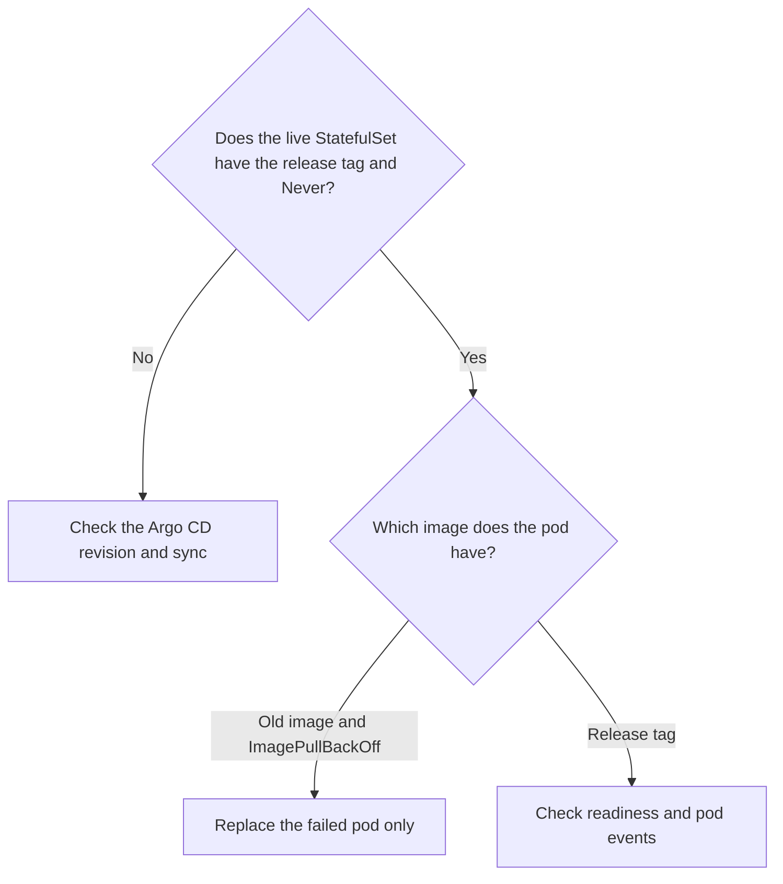

# MinIO ImagePullBackOff on bare-metal Kubernetes

**Resolved:** 21 November 2026 · **Workload:** `ott-media/minio-0` · **Git fix:** [PR #1](https://github.com/rakeshv12/ott-platform/pull/1) ([merge commit](https://github.com/rakeshv12/ott-platform/commit/20474855cc2011291be0bc9be8623e99886dc83c)).

MinIO could not start because the pod requested `rakeshv12/ott-minio` with pull policy `Always`. Docker Hub returned `not found` for `docker.io/rakeshv12/ott-minio:latest`. An earlier configuration had failed separately with a Quay `401 Unauthorized`. The lab already had a working Linux/amd64 image on Windows. We imported it into both workers, updated the StatefulSet in Git, and replaced the failed pod after verifying that it still used the old image.

## 1. Identify which image is failing

**Run on master (Bash).** A StatefulSet is the controller that maintains the named pod and its storage. Compare its desired image with the image on the actual pod:

```bash
kubectl config current-context
kubectl get sts minio -n ott-media -o custom-columns='DESIRED_IMAGE:.spec.template.spec.containers[0].image,PULL_POLICY:.spec.template.spec.containers[0].imagePullPolicy'
kubectl get pod minio-0 -n ott-media -o custom-columns='POD_IMAGE:.spec.containers[0].image,READY:.status.containerStatuses[0].ready,WAITING_REASON:.status.containerStatuses[0].state.waiting.reason'
kubectl describe pod minio-0 -n ott-media | sed -n '/Events:/,$p'
kubectl get pvc minio-data-minio-0 -n ott-media
```

`ImagePullBackOff` means Kubernetes is waiting before another image-pull attempt. The event above it gives the registry error. A persistent volume claim (PVC) is the pod’s request for disk storage. The existing MinIO claim was already bound; keep it throughout recovery.

## 2. Get the release image onto the workers

**Windows PowerShell, on the machine with Docker Desktop.** Use the existing tagged image; the incident did not require a rebuild. The [Dockerfile](../../infra/images/minio/Dockerfile) is the source if the image must be rebuilt later.

```powershell
$image = 'ott-minio:RELEASE.2025-10-15T17-29-55Z'
$archive = Join-Path $env:TEMP 'ott-minio.tar'
docker image inspect $image --format '{{.Os}}/{{.Architecture}}'
docker image save --platform linux/amd64 -o "$archive" $image
if ($LASTEXITCODE -ne 0) { throw 'Image export failed; stop before copying.' }
Get-Item -LiteralPath $archive | Select-Object FullName, Length

$sshUser = Read-Host 'Linux SSH username'
scp "$archive" "${sshUser}@172.16.254.133:/tmp/ott-minio.tar"
scp "$archive" "${sshUser}@172.16.254.134:/tmp/ott-minio.tar"
```

Check that the archive has a nonzero length and both copies succeed. **On each worker** (`node1` and `node2`), run as root or use `sudo`:

```bash
ctr -n k8s.io images import /tmp/ott-minio.tar
crictl images | grep -F ott-minio
```

`containerd` is the software that runs containers on the worker. `k8s.io` above selects its Kubernetes image store. `crictl images` lists stored images; `crictl ps` only shows running containers. The observed result on **both** workers was:

```text
docker.io/library/ott-minio   RELEASE.2025-10-15T17-29-55Z   067f0624547de   71.6MB
```

## 3. Apply the Git change and compare again

The bare-metal Argo CD application watches `main:k8s/ott-media`. [The StatefulSet manifest](../../k8s/ott-media/minio-statefulset.yaml) changed only these two container fields. No AWS, Helm or storage changes were needed.

```yaml
image: ott-minio:RELEASE.2025-10-15T17-29-55Z
imagePullPolicy: Never
```

`Never` tells the worker to use its local copy. Merge only after every eligible worker has the tag. PR #1 is already merged; for this recovery, the expected revision was `20474855`.

**On master**, check the Argo CD application and compare the StatefulSet and pod images from step 1. If the StatefulSet still shows the old image, request one refresh, then recheck. A refresh asks Argo CD to compare Git with the cluster.

```bash
kubectl get application.argoproj.io ott-media -n argocd -o custom-columns='SYNC:.status.sync.status,REVISION:.status.sync.revision,HEALTH:.status.health.status'
# Only if the desired image is still old:
kubectl annotate application.argoproj.io ott-media -n argocd argocd.argoproj.io/refresh=normal --overwrite
```



## 4. Replace the stuck pod only when the evidence matches

Here the application was `Synced` at `20474855`, but `Progressing`. The StatefulSet had the release tag and `Never`; the pod still had `rakeshv12/ott-minio` and `ImagePullBackOff`. With the default ordered StatefulSet rollout, an unhealthy pod can block replacement even after the template is corrected. See [Kubernetes: forced rollback](https://kubernetes.io/docs/concepts/workloads/controllers/statefulset/#forced-rollback).

**Only for that combination**, after confirming the image on the workers, run on master:

```bash
kubectl delete pod minio-0 -n ott-media
kubectl rollout status statefulset/minio -n ott-media --timeout=2m
```

The controller recreates `minio-0` with the same claim. Do **not** delete the PVC or StatefulSet. If the pod already uses the release tag but is unready, inspect its events instead of deleting it again.

## 5. Verify recovery and read the timeline

**On master:**

```bash
kubectl get pod/minio-0 pvc/minio-data-minio-0 -n ott-media
kubectl get events -n ott-media --sort-by=.metadata.creationTimestamp | grep -E 'minio-0|statefulset/minio'
kubectl logs -n argocd argocd-application-controller-0 --since=2h --timestamps | grep -F '"application":"ott-media"' | tail -60
```

| Evidence | What it established |
|---|---|
| `13m` / `10m`: old pod reported `BackOff` / `ImagePullBackOff` | The old registry reference still failed. |
| `8m37s`: `SuccessfulCreate` and `Scheduled` | Kubernetes created the replacement and assigned it to `node1`. |
| `8m35s`: image “already present on machine” | The worker used the imported release image. |
| `8m34s` / `8m33s`: `Created` / `Started` | The replacement container started about four seconds after scheduling. |
| `minio-0  1/1  Running  0` | The pod became ready with zero restarts. |
| Argo CD: `Progressing -> Healthy` at 06:17:32 UTC (11:47:32 AM IST) | Argo CD recorded application recovery. The excerpt does not give the original apply time. |

Event ages are relative to the captured command. Filter controller logs by **application name**: filtering only by commit also picks up `cluster-infra` and `ott-platform-parent`. Their retries do not indicate MinIO failed. Pod readiness confirms startup; it does not test reading an existing media object.

## Prevention and interview takeaway

- With locally stored images, include the tagged image in worker setup. A replacement worker or a cleared image cache needs a fresh import. For a larger cluster, a registry reachable by every worker removes the manual copy step.
- Compare three things before intervening: the Git revision Argo CD reports, the live StatefulSet template, and the image on the pod. **Synced** means the managed configuration matches Git. **Healthy** means the workload is ready. In this incident, only the pod still needed replacement.
